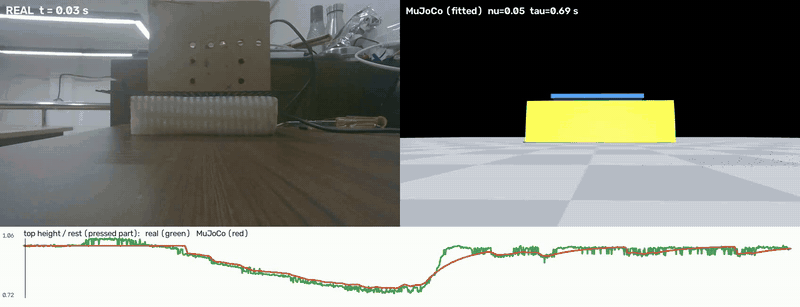
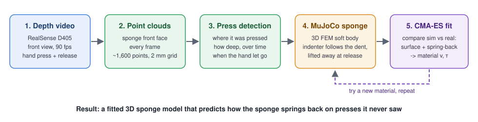
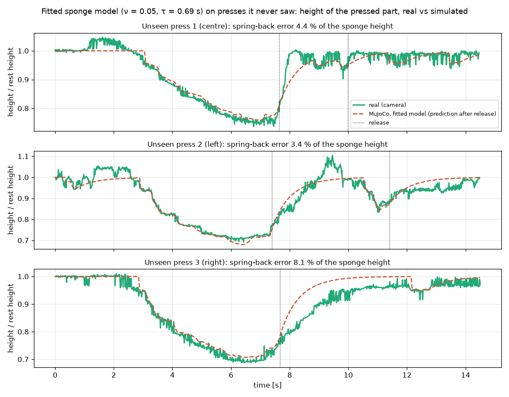

# softfit

Learn how soft a sponge is, and how fast it springs back, from a depth video, then predict new presses with a
3D MuJoCo soft-body model.



*A centre press the model never saw. Left: the real camera. Right: the fitted MuJoCo sponge, seen from the same
camera pose. Bottom: height of the pressed part, real (green) vs MuJoCo (red). After the hand lets go, the
MuJoCo spring-back is the model's prediction.*

## How it works



A kitchen sponge is pressed by hand and released in front of an Intel RealSense D405 depth camera.

1. **Point clouds:** the first frames, with the sponge untouched, set the coordinate frame. Every frame then
   becomes a point cloud of the sponge's front face.
2. **Press detection:** from the top edge of the sponge, measure where it is pressed, how deep, and when the
   hand lets go.
3. **Simulation:** a 3D FEM sponge in MuJoCo is pressed by an indenter that follows the measured dent. At each
   release the indenter is lifted away, so the spring-back is **predicted** by the model, not replayed.
4. **Fit:** CMA-ES finds the material (Poisson ratio ν and damping time τ) that best matches the measured
   surface and spring-back.

## Results

Fitted material: **ν = 0.05, τ = 0.69 s**. On presses it never saw, the predicted spring-back is within
**~5 % of the sponge height** on average (4.4 % on the centre press in the demo).



## Limitations

- **Front camera only.** Only the sponge's front face is measured; the back and bottom are not seen.
- **Small deformations (MuJoCo linear FEM).** The model is accurate up to about 30 % compression; much
  deeper presses make the simulated sponge collapse.
- **Simple indenter (MuJoCo rigid body).** The press is modelled as a flat rigid block of the measured width,
  while the real press goes through a bending sheet.

## Setup

Requires Python 3.12 and [uv](https://docs.astral.sh/uv/).

```bash
uv sync
```

## Reproduce

The processed dataset (point clouds and press detection for six presses, 130 MB) is on Hugging Face:
[Archaive16/sponge-press-rgbd](https://huggingface.co/datasets/Archaive16/sponge-press-rgbd).

```bash
# 1. download the dataset into outputs/
uvx --from huggingface_hub hf download Archaive16/sponge-press-rgbd --repo-type dataset --local-dir outputs

# 2. fit the material on 3 presses (centre, left, right); about 5 min on 24 threads
uv run python scripts/fit_press.py --trials outputs/data/real/press_01.npz outputs/data/real/press_03.npz \
       outputs/data/real/press_04.npz --count 7 5 4 --maxiter 6 --popsize 8 --init 2e4 0.15 0.9 --out outputs/fit

# 3. test on the 3 other presses -> outputs/fit/heldout.png
uv run python scripts/eval_heldout.py --fit outputs/fit/fit.json \
       --test outputs/data/real/press_02.npz outputs/data/real/press_05.npz outputs/data/real/press_06.npz

# 4. watch one press in the MuJoCo viewer (green dots = measured points)
uv run python scripts/replay_trial.py outputs/data/real/press_02.npz --fit outputs/fit/fit.json
```

To skip the fit, use the provided `results/fit.json` in steps 3 and 4.

## Project structure

```
├── scripts/
│   ├── record_rgbd.py     record a RealSense clip (how the dataset was made)
│   ├── export_rgb.py      export the colour video of a recording
│   ├── rgbd_to_pcd.py     recording -> point clouds + press detection
│   ├── fit_press.py       fit the material (CMA-ES)
│   ├── eval_heldout.py    test the fitted model on unseen presses
│   └── replay_trial.py    real vs simulation video / viewer
├── src/softfit/
│   ├── capture.py         recording -> point clouds, press detection
│   ├── press_scene.py     MuJoCo FEM sponge + indenter
│   ├── fit.py             loss function and helpers
│   └── trial.py           data format for one press
├── results/               fitted parameters, held-out figure and scores
├── assets/                demo GIF and pipeline diagram
├── pyproject.toml
└── uv.lock
```
